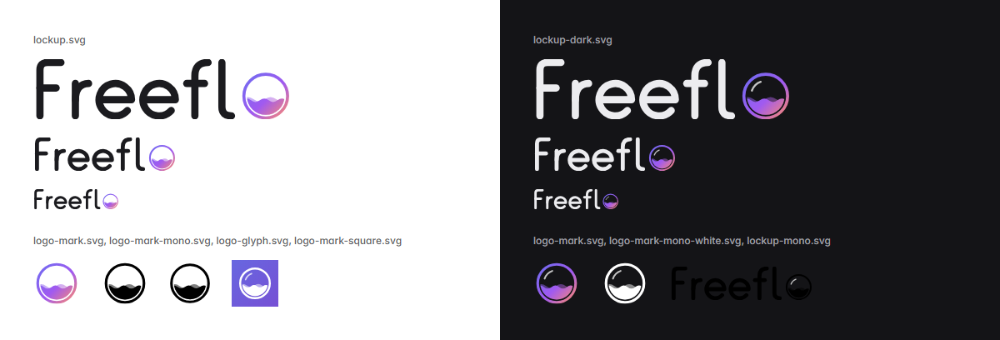
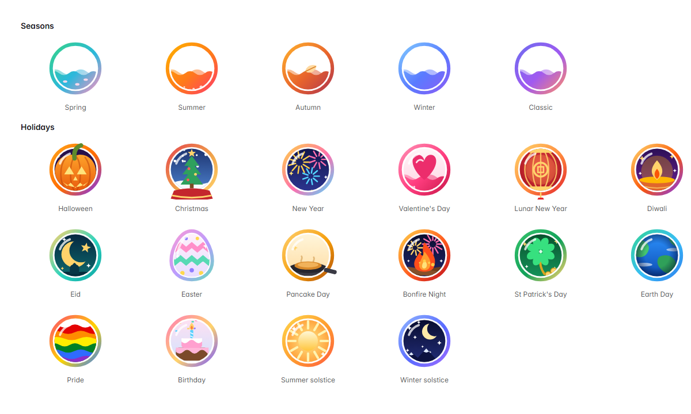

# Freeflo brand

Everything you need to show Freeflo: the logo, the colours, the words, and
what to put in the GitHub repository settings. Every file in this folder is
made by one script, [`tools/release-brand.mjs`](../../tools/release-brand.mjs),
from the orb module the app itself runs
([`src/brand/freeflo-orb.js`](../../src/brand/freeflo-orb.js)), so the logo
never drifts between the app, the website and this folder.



## The name

**Freeflo**: one word, capital F, the rest lower case.

Freeflo was called OpenDash until version 2.23. In code, URLs, folders and
package names the old name `opendash` stays (the GitHub address, the data
folder, the MCP server id), so nothing a user set up stops working. In text
people read, write Freeflo.

Please don't write "FreeFlo", "freeflo" (except in code) or "FREEFLO".

## The logo

The name is written in one stroke, and its last **o** is an orb: a glass sphere
of moving liquid. The orb is a little larger than the letters beside it, sits on
the baseline and reaches up past the x-height, so it reads as the one living
thing in the word.

- **The letters** are drawn as strokes (12 units wide on a 100-unit line), not
  set in a font, so they look the same everywhere and can be written on. The
  opening draws them left to right and then the orb drops in, squashes and settles.
- **The orb** is a ring (3.6 units on a 64-unit square) around an inner circle of
  radius 22.4. Inside are two translucent waves that slide in opposite
  directions and a slow slosh. A short white arc at the top left is the glass.
- **Motion** is CSS inside the SVG, so the same markup works inline, as an
  ``, as a data URL and in a favicon. Reduced motion and the app's motion
  level hold it still.

## It follows the year

The orb takes the colours of the season (meteorological seasons; the southern
hemisphere is flipped from the time zone), and for a few days around a holiday
it becomes the holiday.



| Season | From | To | Via |
|---|---|---|---|
| Spring | `#35d28a` | `#ff8fc1` | `#2cb8dc` |
| Summer | `#ffb000` | `#ff3d68` | `#ff7a1a` |
| Autumn | `#ffb02e` | `#b0364f` | `#e8642c` |
| Winter | `#7fc8ff` | `#8b5cf6` | `#5a7bff` |
| Classic | `#6f6cf0` | `#ff8a6b` | `#a05af0` |

| Holiday | When it shows |
|---|---|
| Halloween (jack-o'-lantern) | 24 to 31 Oct |
| Bonfire Night | 3 to 5 Nov |
| Diwali (diya) | two days either side |
| Christmas (snow globe) | 20 to 26 Dec |
| New Year (fireworks) | 29 Dec to 2 Jan |
| Lunar New Year (lantern) | two days before to six after |
| Valentine's Day (heart) | 10 to 14 Feb |
| St Patrick's Day (clover) | 15 to 17 Mar |
| Easter (egg) | Good Friday to Easter Monday |
| Pancake Day | Shrove Tuesday |
| Earth Day | 22 Apr |
| Eid (crescent and star) | Eid al-Fitr and Eid al-Adha, three days each |
| Pride (rainbow) | June, except the solstice days |
| Solstice (sun, or a starry night in the other hemisphere) | 20 to 22 Jun |
| Birthday (cake) | the birthday set in Settings |

The moon-following festivals use the same table as the almanac
(`src/app/71-anim-almanac.js`, 2025 to 2031). The user can follow the year (the
default), keep seasons only, keep the classic colours, or pin any one from the
workspace icon menu (Logo style). `localStorage freeflo-logo` holds the choice,
and `?logo=<id>` previews one without saving it. To see any day,
open [`prototypes/freeflo-orb-gallery.html`](../../prototypes/freeflo-orb-gallery.html).

## Files

### The orb

| File | What it is | Use it for |
|---|---|---|
| `logo-mark.svg` | **Primary.** The classic orb, indigo to coral | The default, on any background from white to black |
| `logo-mark-mono.svg` | One colour (`currentColor`) | One-colour printing; inherits the text colour when inlined |
| `logo-mark-mono-white.svg` | The same, in white | Photos and dark solid colours |
| `logo-mark-square.svg` | The white orb on the indigo tile, square corners | App stores and launchers that round the corners themselves |
| `logo-glyph.svg` | The orb on its own, one colour, cropped to the ring | Tiny inline use next to text |
| `favicon.svg` | The classic orb | Browser tabs and bookmarks (the app swaps in today's orb) |
| `orbs/<id>.svg` | Each season and holiday, still | Documents and slides that want the orb of the day |

### The name

| File | Colour | Use it for |
|---|---|---|
| `lockup.svg` | Ink `#1b1b1f`, classic orb | README headers, slides, anywhere the name appears, on light |
| `lockup-dark.svg` | Mist `#ececef`, classic orb | The same, on dark |
| `lockup-mono.svg` | All `currentColor` | One-colour use |

### Bitmaps

All PNGs are rendered by headless Chrome from the SVGs above, then stripped of
every metadata chunk (no text, time, colour profile or EXIF): they contain only
`IHDR`, `IDAT` and `IEND`.

| File | Size | Notes |
|---|---|---|
| `png/icon-16.png` | 16 x 16 | From `favicon.svg`; transparent corners |
| `png/icon-32.png` | 32 x 32 | Transparent corners |
| `png/icon-180.png` | 180 x 180 | Transparent corners |
| `png/icon-192.png` | 192 x 192 | Web app manifest |
| `png/icon-512.png` | 512 x 512 | Web app manifest, large previews |
| `png/apple-touch-icon.png` | 180 x 180 | Opaque, square corners (iOS rounds them) |
| `png/icon-maskable-512.png` | 512 x 512 | Opaque, square corners, for `"purpose": "maskable"` |
| `favicon.ico` | 16, 32, 48 | For older browsers and Windows shortcuts |
| `social-preview.png` | 1280 x 640 | The GitHub repository card (see below) |

`src/social-preview.html` is the social card. Everything in its mock window is
made up (Alex, Sam, Acme, a product launch): keep it that way.

## Colour

The colours of the interface itself come from the app's design tokens
([`src/styles/00-tokens.css`](../../src/styles/00-tokens.css)).

| Name | Value | Where |
|---|---|---|
| Indigo | `#5b5bd6` | The app's accent (`--accent`, light theme). Links, primary buttons, highlights |
| Tile | `#6767e0` to `#7650d4` | The app-icon tile, top-left to bottom-right |
| Ink | `#1b1b1f` | Text on light (`--fg`); the name on light |
| Mist | `#ececef` | Text on dark (`--fg`, dark theme); the name on dark |
| Paper | `#ffffff` | Light background (`--bg`) |
| Night | `#141417` | Dark background (`--bg`, dark theme) |

The name is always ink or mist, never a gradient: the seasons colour the orb,
not the letters, so the name stays legible on any day.

## The words

- **One line:** Plan your day. Keep your data.
- **Short:** A calm, local-first dashboard for your tasks, calendar, money and
  friends. It runs on your own computer.
- **Don't say:** a cloud service, an account, "sync to our servers". Nothing
  Freeflo does needs them.

## GitHub repository settings

- **Description:** Freeflo: a calm, local-first dashboard for tasks, calendar, money and people, with an optional Claude assistant.
- **Topics:** `dashboard`, `productivity`, `local-first`, `personal-dashboard`, `tasks`, `calendar`, `mcp`, `claude`, `nodejs`
- **Social preview:** upload `social-preview.png` (Settings > General > Social preview).
- **Website:** the GitHub Pages address.

## Making the files again

```bash
node tools/release-brand.mjs           # the SVGs, PNGs, favicon.ico, social card and previews
node tools/release-brand.mjs --svg     # the SVGs only (no browser needed)
node tools/release-brand.mjs --check   # fails if a committed SVG differs from the script
```

## Licence and credits

The orb, the letters and the holiday scenes are drawn for this project and are
MIT like the rest of the repository. The interface font, Inter, is
SIL Open Font License 1.1 (see `THIRD_PARTY_NOTICES.md`); the wordmark uses no font.
