# Using OpenDash

A tour of OpenDash, area by area. Everything here works without any
connection; features that need Claude or an account are marked
**(needs Claude)** or **(needs a connection)** and stay visible but greyed
out until you connect them in **Connections**.

The screenshots show invented demo data, like the demo data you can load from
the welcome screen.

- [Getting around](#getting-around)
- [Home](#home)
- [Tasks](#tasks)
- [Quick add](#quick-add)
- [Calendar](#calendar)
- [Money](#money)
- [People and tags](#people-and-tags)
- [Files & links and auto-linking](#files--links-and-auto-linking)
- [Morning brief, Finish the day and the weekly review](#morning-brief-finish-the-day-and-the-weekly-review)
- [Expenses](#expenses)
- [The assistant](#the-assistant)
- [Life: garden, pets, achievements, memories, places and your profile](#life-garden-pets-achievements-memories-places-and-your-profile)
- [Friends](#friends)
- [The command palette](#the-command-palette)
- [Settings, backups and sharing](#settings-backups-and-sharing)
- [The server](#the-server)
- [Keyboard shortcuts](#keyboard-shortcuts)

## Getting around

- The **tiles** at the top of the sidebar switch between **Home**, **Tasks**,
  **Calendar**, **Money** and **Life**. The sidebar below them changes with the
  area: under Home it holds Home and the **Plan** pages (Finish the day,
  Weekly review, Plan my week, History); the task views, streams, tags and
  people are under Tasks.
- **Tasks** shows Inbox, Today, Upcoming and All tasks up front. The other
  views (Do now, No date, Waiting, Someday, Logbook, Wins, Email triage, Files
  and links) wait under **More views**; Waiting, Email triage and Do now come
  up by themselves while they need you. *Customise sidebar* sets each one to
  Shown, In More or Hidden.
- **Life** holds the fun side of OpenDash: **Friends**, **Garden**, **Pets**,
  **Achievements** (your level, streaks, quests and the achievements wall),
  **Memories** and **Places** (where you have been, and your trips), with a tab
  for each at the top of every Life page. Under **You** in its sidebar: your
  profile, the wardrobe and your status. Your avatar's menu has **Open Life**
  and an icon for each part.
- **The Garden** is a full-screen game: plant seeds on free tiles, water them,
  pick what is ripe and decorate. The bar on top shows your level, coins,
  water, seeds, the season and the next daily goal; the tools are on the left
  (Plant, Water, Harvest, Fertilise, Trim, Dig up, Decorate; keys 1 to 7); your
  seeds are in the tray under the garden (click one, then a tile, or drag it
  in); the panel on the right always suggests **what to do next**. **Coins come
  from time spent working**: about 12 coins an hour while the focus timer runs
  on a task (sessions under 5 minutes do not count), a bonus when you finish a
  task for the time it took, at most 120 a day; quick or empty tasks pay
  nothing and each task pays once. The **Help** button explains everything and
  replays the first-run tour. Plants never die: a thirsty one only droops.
- **All pages** (the grid button next to the search box, the last row of
  every sidebar, or G then G) lists every page with a one-line description:
  type to find one, Enter opens it, Shift+Enter pins it to the sidebar.
- A small dot marks a page you have not opened yet; it goes when you visit.
  The path at the top of the page (Life › Places › Trips) is clickable, and a
  page you reached from a link inside another one offers **Back to** where you
  were. Home cards' titles open the page behind them.
- The **top bar** shows where you are, your countdowns and widgets, and
  whether everything is saved.
- **Ctrl+K** (Cmd+K on a Mac) opens the **command palette**: type to jump to a
  view, run a command, find a task, person or file.
- Every view has its own address (`#view=calendar`, `#view=people`...), so
  browser Back and bookmarks work.
- Clicking the thing you are already on does nothing (except scrolling back to
  the top). The current item is highlighted wherever it appears.

## Home

Home is the landing page: a board of widgets for today. Its pages (**Today**,
**Evening**, **Week** and **History**) are tabs at the top and rows in the
sidebar. The top shows a greeting, a couple of ideas and one button for the AI
day review **(needs Claude)**; the cards below are grouped under *Today*,
*Coming up* and *Money and life*.

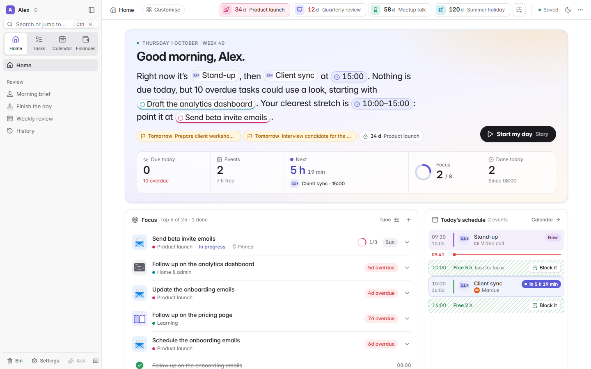

| Widget | What it shows |
|---|---|
| **Today** | the date, weather, your day in a few lines with links to what it names, deadlines and countdowns, a few numbers (due, events, next, Focus, done) and *Start my day* or *Finish the day* |
| **Focus** | the few tasks that matter most right now. Click a row to open it in place: its description, the whole checklist, folders, people and time, with *Done*, *Snooze*, *Reschedule* and *Open full card*. Drag a row onto a day in *This week* to move it |
| **Today's schedule** | today's events and planned tasks in order with a line for now, the next event, and free stretches of 45 minutes or more inside your working hours with *Block*, which books the time in your calendar |
| **Suggested links** | folders, meetings and people that auto-linking found for your tasks, to accept or reject (hidden until you add it) |
| **Waiting on** | tasks waiting on someone, oldest first, with *Nudge*, which drafts an email (it never sends one) |
| **Money** | spending today, this week and this month against your usual pace, with the latest payments **(needs Finances data)** |
| **People today** | who you meet today and why it matters, and who is waiting longest on you |
| **This week** | the next seven days: what is due, countdowns and events; drop a task on a day to move it |
| **Countdowns** | the dates you are counting down to, as big numbers |
| **Morning brief** | your day in three sentences, the shape of the day, what is due, Focus and money tiles, ideas; *Play* runs the story right in the panel (and full screen) |
| **Suggestions** | one-click ideas for your day (see below) |

Widgets with nothing to show stay out of the way until they have something.

More widgets wait in **Add widget** (Customise > Add widget), each with a
*New* badge until you have looked at it:

| Widget | What it does |
|---|---|
| **Quick capture** | type a task the quick way (`#tag @person tomorrow p1`), use a template, sort what you just added |
| **Fill the gap** | the free time until your next event and the task that fits it; *Block* puts it in your calendar |
| **Plan my day** | how much of today's free time your plans fill, a timeline you can drag tasks onto, and *Auto-plan* |
| **Meeting prep** | your next meeting with people: what you owe them, what you wait on, the agenda, a follow-up task, an email to everyone **(needs a calendar)** |
| **After meetings** | a note, a follow-up or a thank-you for each meeting that just ended **(needs a calendar)** |
| **Invites & clashes** | invitations to answer, clashes, back-to-back meetings, meetings with no link **(needs a calendar)** |
| **Needs reply** | emails from people waiting on you: make a task or write a reply draft **(needs a mailbox)** |
| **I owe** | what you promised whom, with *Today* and *Write* |
| **Catch up** | what slipped, and the tasks that keep moving |
| **Deadline runway** | will you make a countdown at your recent pace? (up to four) |
| **Smart list** | any search as a list or a board (up to six) |
| **Habits & routines** | your repeating tasks as streaks |
| **Launchpad** | pinned folders, links and snippets, one click away |
| **Payday & safe to spend** | how much a day is safe to spend until payday, the bills before it **(needs Finances data)** |
| **Daily note** | one running note per day; a line can become a task |
| **What changed** | what assistants, MCP clients and scripts changed today, with Undo |

**Every suggestion and widget button works the same way.** The main button
opens the normal editor already filled in (a new event, a task, an email
draft): change anything, then press *Save*. Nothing is saved before that. The
small **✓** beside it does the suggestion exactly as offered, at once, with
*Undo*. Blocking time always makes a calendar event (and plans the task for
that day); it never moves a deadline. Email is only ever saved as a **draft** in
Gmail: OpenDash cannot send email or move money.

**Tune Focus** with *Tune* on the Focus widget: how many tasks it shows (3 to
7), what it includes (overdue, pinned, in progress, planned for today, high
priority, and tasks due within 1, 3 or 7 days), which streams, *Reset order*,
and *Show N hidden* to bring back tasks you hid for today.

**Customise** (beside "Home" in the top bar, *Customise Home* at the foot of
the page, or press and hold a widget's title) lets you drag widgets anywhere,
resize them to any size (gaps fill themselves, so the page never has holes),
pick a preset (Focused, Balanced, Everything or Fun), change
a widget's options where it has them (Focus: *Tune*), hide them, add them back
with *Add widget*, or *Reset* the layout; *Done* or Esc finishes. With a
widget focused: Alt+arrows move it, + and - (or 1 to 4) resize it, Delete
hides it, and A opens *Add widget*. Settings > Home has the same switches for
the brief and suggestions panels, *Hide amounts* (blurs money until you point
at it) and your working hours.

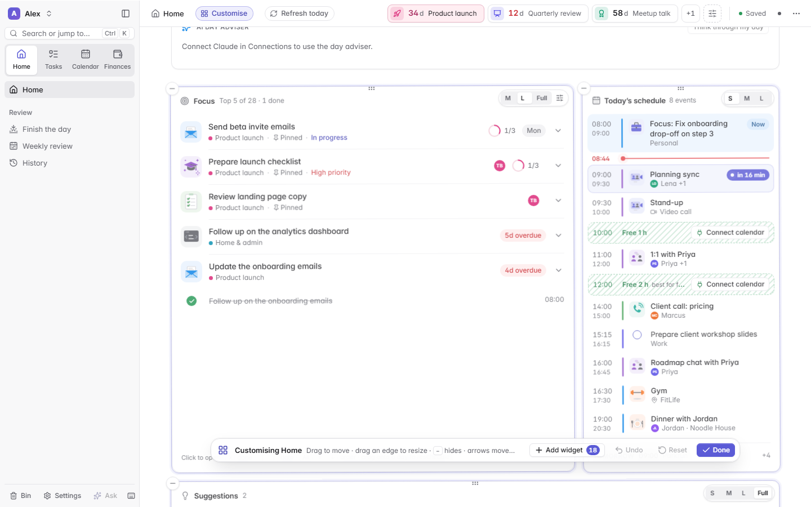

**A new, empty Home** shows a welcome with three steps instead: add your first
task, connect a calendar, or load demo data to look around.

## Tasks

- **Streams** are the big areas of your life or work (for example Work,
  Projects, Personal). Each has its own colour, shape and symbol: right-click a
  stream, tag or person anywhere to customise or rename it.
- A task has a title, stream, priority (p1 to p3), due date and time, a
  **planned day** (when you will work on it, separate from the deadline), an
  estimate, tags, people, subtasks, notes and a history.
- **Views**: Inbox (quick captures waiting to be sorted), Today (in sections:
  Overdue, Due today, Planned for today, In progress), Upcoming, All tasks,
  and under *More views* Do now, No date, Waiting, Someday, Logbook (done),
  Wins, Email triage and Files and links; plus by stream, by tag, by person,
  your **smart lists** (any search saved as a list) and the Bin.
- **One layout switcher** on every list: **List**, **Board** (columns by
  status, priority, stream, tag, person, due date or your own, with swimlanes
  and saved boards), **Timeline** (drag tasks onto days and free time in the
  week), **Matrix** (urgent and important in four boxes) and **Review** (one
  task at a time). V and Shift+V flip through the first four. *Display > Show on rows*
  picks what rows show.
- **Planning helpers** (the header's *More*): the guided weekly review, *Plan
  my week*, the clean-up helper for stale, duplicate and dateless tasks, and
  the Today to Tomorrow sweep (Shift+T).
- **Waiting and blocked**: a task waiting on someone moves to *Waiting*,
  grouped by person, with nudges to follow up; a task *blocked by* another
  steps out of Today until the way is clear.
- **Search and filter** with `/`, using operators: `#tag`, `@person`, `p1`,
  `is:done` (or `open`, `doing`, `wontdo`, `pinned`, `planned`, `inbox`,
  `waiting`, `blocked`, `someday`), `due:today` (or `overdue`, `tomorrow`,
  `week`, `month`, `none`), `stream:work`, `ctx:phone`, `energy:low`,
  `est:<=15` or `est:<1h`, and `-word` to exclude a word.
- **Focus timer** on any task; the time counts toward your game progress and
  your garden coins.
- **Repeating tasks** move to their next date when you complete them.
  *Won't do* closes a task without counting it as done.
- Select several tasks for **bulk** changes: Ctrl+click (Cmd+click on a Mac)
  adds one, Shift+click a range, Shift+Up/Down extends the selection.
- **Undo** (Ctrl+Z) and redo work everywhere. Deleted tasks go to the **Bin**,
  where you can restore them.
- Right-click a task (in a list, on a board, in the calendar or in Focus on
  Home) for its menu.
- Tasks and calendar events open in the **centre card** (default) or the
  **side panel** (Settings > Tasks > *Open tasks and events in*); each has a
  button to switch to the other. Drag the card's edges to resize it, or press
  M to maximise it.

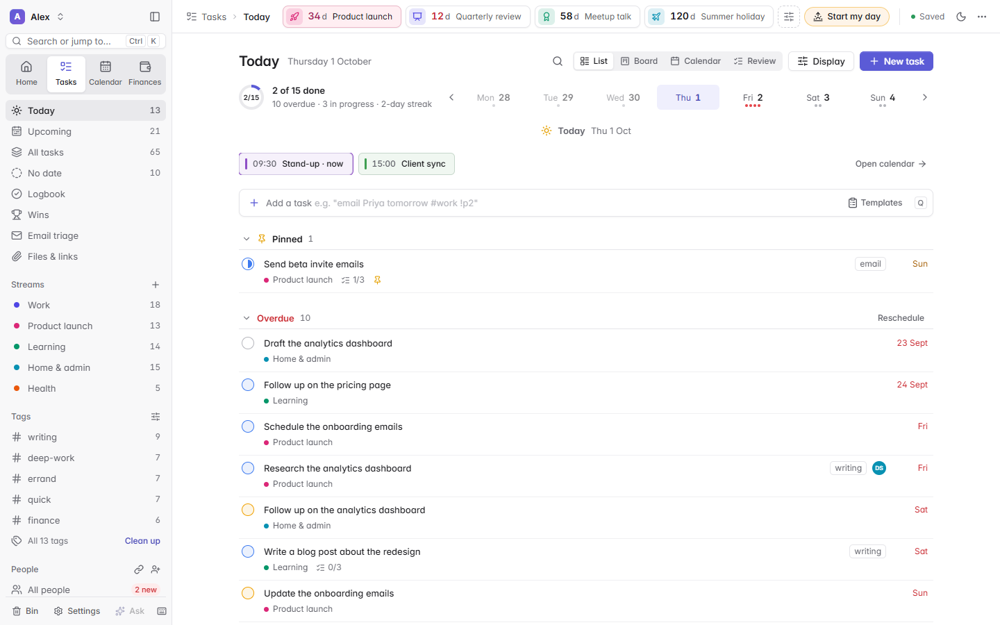

<!-- media: a task board with columns by status -->

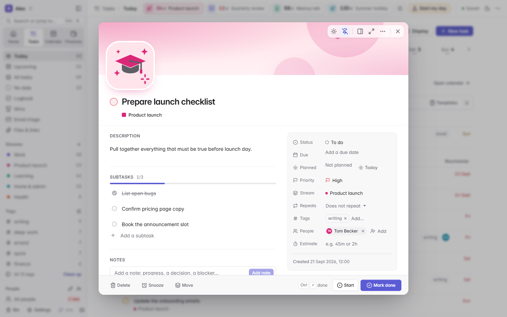

## Quick add

Press **Q** anywhere (or use the box at the top of a list) and type a task in
plain words. Chips show what was understood; click a chip to keep that part as
text instead.

| Type | Example | Meaning |
|---|---|---|
| a date at the end, or after "due"/"by" | `fri`, `tomorrow`, `next week`, `in 3 days`, `15 oct`, `2026-10-15` | due date |
| a time | `3pm`, `9:30am`, `14:00` | due time |
| a repeat | `every week`, `every 2 weeks`, `daily`, `every monday` | recurrence |
| `!p1` (or `p1` at the end) | `!p2` | priority |
| `#word` | `#work` | the stream if one has that name, otherwise a tag |
| `+word` | `+projects` | stream |
| `@name` | `@Sam` | link a person (a new name creates them) |
| `~time` | `~30m`, `~1.5h` | estimate |

Examples:

```
Send Alex the slides fri 3pm #work !p1 ~1h
Call the dentist #personal tomorrow 9am
Water the plants every week
Draft the Acme proposal due fri p2
```

Dates only count at the end or after "due"/"by", so a title such as
"Email Sam about the Sun article" stays as you typed it. Paste several lines
to add several tasks at once.

## Calendar

- **Month, week, day and agenda** views (the tabs at the top, with the filter
  and *New* beside them), with your tasks, planned blocks and countdowns next
  to your events. The day or event you pick shows in the panel at the side.
- **Drag a task** onto the week or day view to plan it for a time slot. A
  planned slot (dashed, "Planned") keeps the task's deadline as it is.
- **Working hours** (Settings > Home, 09:00–18:00 Monday to Friday unless
  you change them) decide what counts as free time on Home and in suggestions.
- **Writing to Google Calendar** **(needs a connection)**: create, move and
  edit events, answer invitations (always after a confirm), with *Undo*.
- Click an event for its details: join link, attendees (linked to People),
  related tasks, your own notes and agenda, *Create task*.
- The sidebar lists your calendars; switch each on or off, rename or recolour
  it (in OpenDash only).
- Calendars that belong to other people start switched off once your email
  addresses are in Settings > Region & language. If you switch one on, it shows
  in the Calendar only: Home, the brief and the stories keep to your own day
  (your calendars and the events you are invited to, without the ones you
  declined).
- Events come from Google Calendar or any other calendar source you add,
  including **iCal links** **(needs a connection)**. *Update now* refreshes
  them. See [CONNECTIONS.md](CONNECTIONS.md).

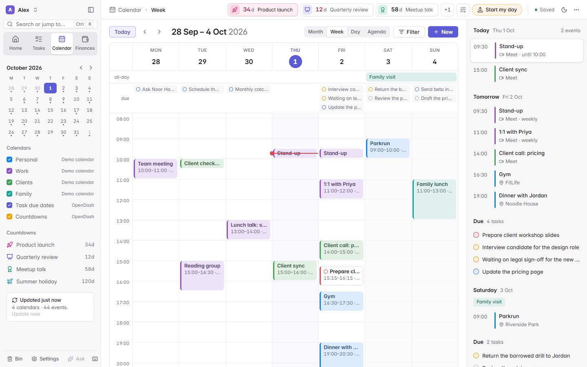

## Money

<!-- media: Money Overview with the welcome banner, safe to spend and the Money brief button -->

**Money** works with no connection at all: import a CSV from your bank, or
connect a bank in Connections ([CONNECTIONS.md](CONNECTIONS.md#money-banks-and-wallets)).
It has five tabs, along the top and in the sidebar; a tab with more than one
view has a small switch inside it:

| Tab | What is in it |
|---|---|
| **Overview** | **My money**, a board of widgets you arrange like Home (drag anywhere, resize to any size), and the **Money brief** |
| **Spending** | spending over time, categories, merchants and spending by country (flags, local currencies, trips) |
| **Cash flow** | money in and out, what you kept, and your recurring payments and subscriptions (with cancel reminders) |
| **Budgets** | a budget per category, against what you have spent |
| **Transactions** | every payment, with search, sort and type in one row; label one as an expense from here |

**Expenses** sits beside them in the sidebar ([below](#expenses)).

- **The welcome banner** on Overview greets you over the sky, says what is
  *safe to spend* today, and has a big **Play money story** button with
  **Money brief** beside it. The little cross hides the banner, and *More*
  brings it back.
- **The Money brief**: how this pay cycle (or month) is going against your
  usual pace, "your money in three sentences", what is safe to spend a day
  until payday, the bills before payday and the biggest movers, plus **Worth
  a look** (possible duplicates, unusually large payments, price rises, new
  merchants). *Read aloud* reads it out; with Claude connected the three
  sentences can be worded by Claude **(needs Claude)** from your totals, and
  every number is checked against them.
- **The money story** (*Play money story*) is a short, read-aloud recap of the
  month or week: spent against usual, the top category, your top places, the
  biggest one-off, bills ahead, what you kept and a few fun facts. Its numbers
  are the Overview's own.
- **One row of controls**: pick the period, and one **Filters** button for
  trip, country and category (plus the date slider and Group by / Compare on
  the other tabs). Layout, plain words, **Hide amounts** and the Money brief
  are under **More**.
- Click a category, merchant, bar or day to filter everything by it; the chip
  or Esc clears it. A wrong category? Change it once for that merchant; you
  can undo it.
- **Import CSV** (export transactions from your bank's website, any date
  range; overlaps are fine) and *Export all transactions* are in the menu.
  After an import a short note at the top says what came in.
- **Friends' money**: if a friend shares their money summary with you, the
  *Mine* switch in the header shows theirs (read-only).

Finance data never enters the task state. A bank synced through Claude's
Bank connector passes its transactions through Claude on their way in (a CSV
import or a direct bank connection does not); after that, models see totals
only: never single transactions through the MCP server, and the money brief's
rewrite gets totals and the next few bills only. See [PRIVACY.md](PRIVACY.md).

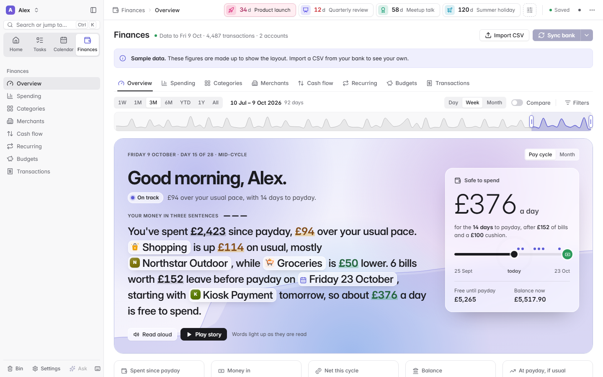

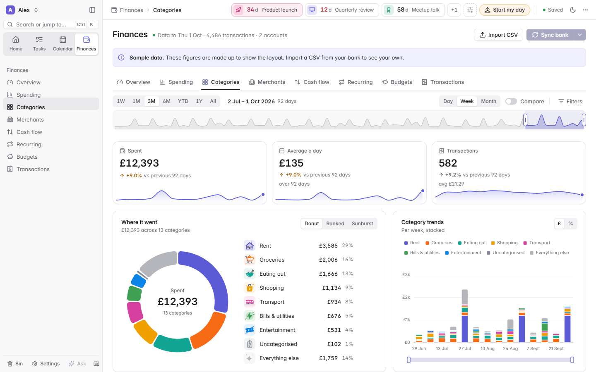

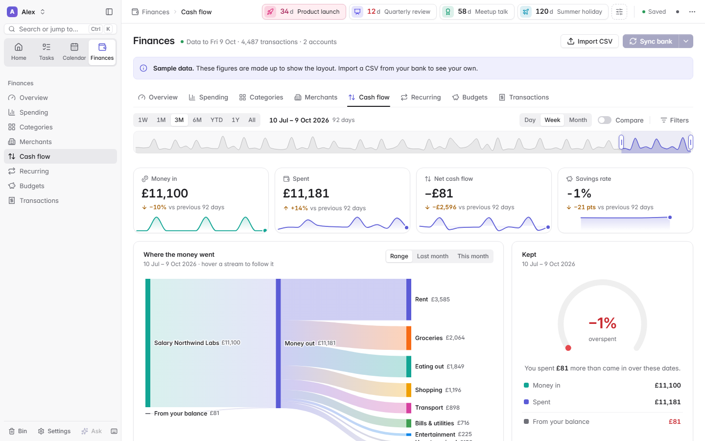

## People and tags

- **People** holds the people (and organisations or shared mailboxes) you
  work with: role, organisation, emails, notes, and the tasks linked to them,
  split into *you owe them* and *waiting on them*.
- Tasks are linked to people explicitly, by a tag that names them, or by their
  name in the title (OpenDash suggests the link).
- **Tags** say what kind of work a task is or which cross-stream project it
  belongs to. The tag manager renames, merges, pins and archives tags
  everywhere at once.
- **Right-click** a stream, tag or person wherever it appears (or press the
  Menu key or Shift+F10 on it, or long-press on a touch screen) to rename it,
  change its colour, symbol and shape, and reach the actions that belong to it.

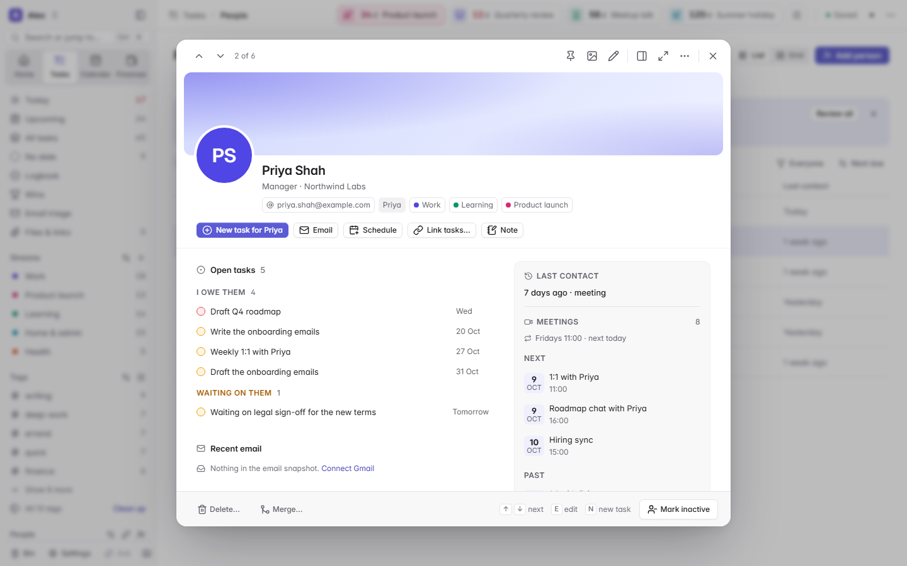

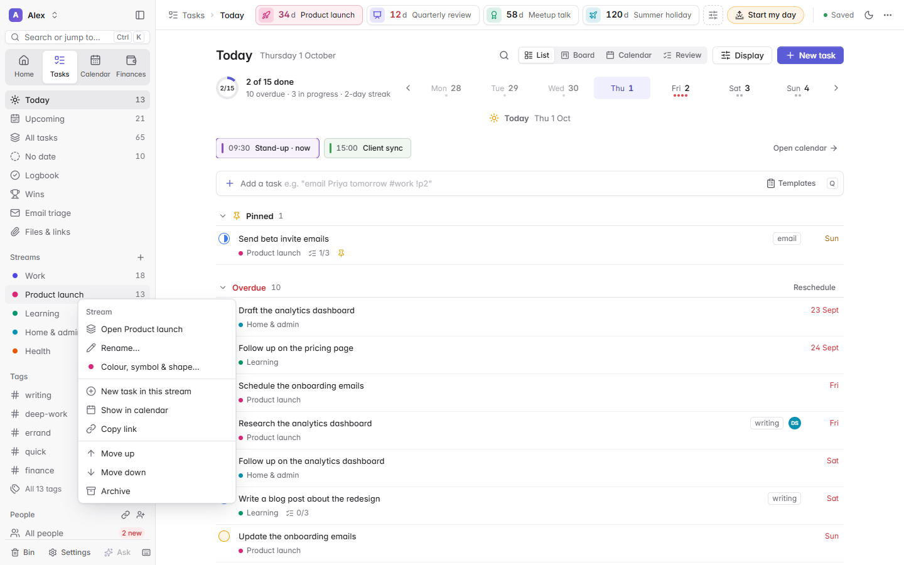

## Files & links and auto-linking

- Attach **folders, files, web links, GitHub repositories, pull requests and
  issues, Google Drive files and code snippets** to tasks, streams and people.
  Open, reveal, explore a folder, copy a path or link, or send it.
- OpenDash only opens items you saved. Programs are never launched from it
  (only revealed in your file manager).
- **Auto-linking** (Settings > Files & auto-link): choose your workspace
  folders, and OpenDash finds the folder, repository, meetings, emails, people
  and related tasks each open task belongs to. Folders you mark "names only"
  are never opened. With Claude connected, an optional judge rates the
  suggestions; confident ones are attached for you (with Undo), the rest wait
  in *Suggested links*.

## Morning brief, Finish the day and the weekly review

Each of the three is a page under **Plan** in Home's sidebar (Morning brief,
Finish the day, Weekly review, History), and each can also play as a
full-screen **story**: your day in a few sentences as big type that lights up
word by word while it is read aloud, with scenes for your events, the people
involved and the tasks that matter.

The same brief also lives on Home as the **Morning brief** panel, under the
Today hero: *Play* runs the story right in the panel (and full screen). It
switches to the evening recap from your evening hour and to the week on your
weekly-review day.

- **Start my day** (on Home, or in the palette) opens the **morning brief** and
  plays the morning story: a greeting and the weather, the day in three
  sentences, the timeline with what is next, who you will see and why, your
  Focus three with their subtasks, deadlines, countdowns and money, then
  *Let's go*. The brief page has the same facts to read at your own pace. It
  can open by itself on your first visit each day (Settings > Brief and stories).
- **Finish the day** is offered on Home from the evening (17:00 by default;
  Settings > Brief and stories > *Offer "Finish the day" from*). It counts what you
  did, shows who you saw, lets you roll over what slipped (tomorrow, the day
  after, next week, or drop it) and say why, shows tomorrow's first event and
  weather, picks tomorrow's top three, and ends with a line about the day, a
  mood and a journal note. *Close the day* saves the recap.
- The **weekly review** opens as a story the first time you visit it each week
  (or as the step-by-step page: Settings > Brief and stories > *Weekly review opens
  as*), and OpenDash offers it from Friday afternoon. It shows the week's
  numbers and wins, progress by stream, the people of the week, what slipped
  and why, next week against your capacity and three outcomes to aim for, then
  hands over to the guided review. Saved reviews are in Review > History.
- **In the player**: Space plays or pauses, the arrow keys move between
  moments, M mutes, Home replays and Esc closes; 0.8×, 1× and 1.25× speeds;
  *Open details* goes to the page.
- **The words**: a built-in script plays at once. With Claude connected,
  Claude can write the day's sentences (Settings > Brief and stories > *Model for
  the story script*), and the brief can add a short AI summary (*Day in three
  sentences*).
- **Read aloud** uses your browser's speech voices (Settings > Brief and stories >
  *Story and narration*: *Read it out*, *Voice*, rate, pitch, volume and story
  speed, and *Test the voice*). Voices built into your computer keep
  everything on it; voices marked *(online)* in the list send the text to the
  browser maker's speech service, so pick another voice if you prefer (see
  [PRIVACY.md](PRIVACY.md)). Captions are always on screen, and without a
  voice the story plays silently.
- Settings > Animations controls the scenes and celebrations, and Settings >
  Appearance > *Reduce motion* (or your system's setting) keeps everything
  still.
- **Weather** needs a town in Settings > Region & language (*Your
  location*). It comes from Open-Meteo (no account); see
  [PRIVACY.md](PRIVACY.md).

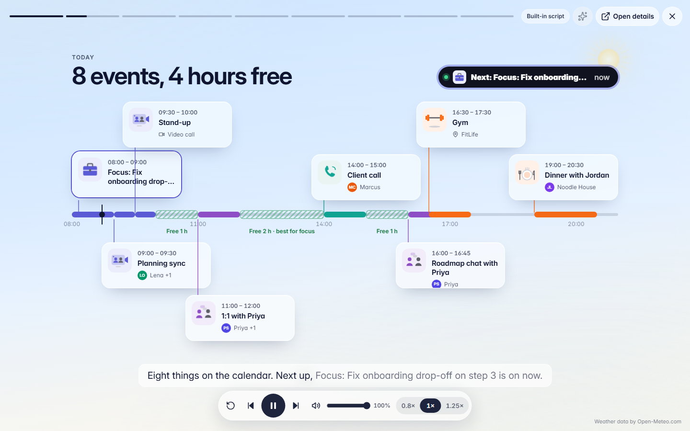

## Expenses

<!-- media: Expenses, the list with what you are owed on top and one expense with its receipts -->

For money you spend on someone else's behalf (your employer, a client, a friend) and want paid back. Find it under **Money > Expenses**; **Owed to you** on Home shows the total.

- **Add one**: on a purchase in Money > Transactions press **Expense**, or press **Add an expense** on the page (for a card that is not connected), or **More > Make this an expense** on a task. Pick who pays you back; OpenDash remembers them.
- **Receipts**: drop a PDF or photo on the expense (or paste, or choose a file). If your email is connected, receipt emails that match the amount and date are suggested; one click links them. Nothing is sent anywhere.
- **Claim**: select expenses and press **Submit**. Copy the summary or download the pack (a summary page, a spreadsheet and the receipts), send it yourself, then **Mark as submitted**. Every step has Undo.
- **Expense report (PDF)**: tick the expenses and press **Make expense report**. OpenDash fills in an expense form (A4 landscape PDF: your name, the pay period, one row per expense in the right column, totals and advances) and zips the receipts, named to match the rows. Both go in a new folder in `Documents/Expense reports/`, which opens for you. The columns are chosen automatically; click a column name to change one. The expenses are marked as submitted, with one Undo.
- **Your signature** (More > *Your signature…*): add a PNG or JPEG once and it goes on the Claimant line of the report. It stays in your data folder and is never shared.
- **Paid back**: when money arrives from the payer that equals a claim (or several together), it is marked **Paid** with an Undo. If OpenDash is not sure it asks one question (Yes / No) and never guesses. Payers' bank text and claim deadlines are in **More > Payers and deadlines**.
- **Tasks**: each expense gets "Submit expense" and "Check <payer> paid" tasks (switch off in **More**). Finishing the first offers to mark the expense submitted; marking it paid finishes the second.
- **Claude**: ask it to file an expense from a pasted order. It asks you who the payer is when unsure.
- **Private**: expenses and receipts sync only between your own computers with encrypted sync, and are never shared with friends.

## The assistant

**(needs Claude)** Press **Ctrl+J** or choose *Ask* in the sidebar, and say
what you want in plain words: "What is due this week?", "Move everything for
Acme to next Monday", "Add a task to email Sam on Thursday, high priority".

- The assistant looks things up itself and **proposes** changes. Nothing
  changes until you press **Apply**; with several changes you can tick only
  the ones you want. Every applied change can be undone.
- Text inside emails, calendar invitations, bank data or notes can never
  change your data on its own.
- Per-task chat (in a task's detail), email triage suggestions and the short
  summaries in the brief use Claude too.
- It can also **file expenses**: tell it about a purchase or paste an order,
  and it adds the expense (with Undo), attaches a receipt email or a PDF or
  picture already on your computer, and marks claims as submitted.
- What it changes shows up on the page by itself, without a refresh.

## Life: garden, pets, achievements, memories, places and your profile

**Life** is the fifth area, for the fun side of OpenDash. Each part is a tab
at the top of every Life page; G then L opens it.

| Page | What it is |
|---|---|
| **Friends** | your friends, what they share with you, shared spaces ([below](#friends)) |
| **Garden** | a full-window garden game (see [Getting around](#getting-around)): plant, water, harvest and decorate, a shop, an almanac, seasons and visitors, photo mode and a time-lapse. Coins come from focus time and time logged on tasks |
| **Pets** | adopt a pet from 18 species, feed it, teach it tricks, play, dress it up and read its journal. It appears on Home, in your garden and on your profile card |
| **Achievements** | your level, streaks, quests and the wall of everything you can earn, with your history and rewards |
| **Memories** | a daily journal with a mood, *On this day*, your year as a heatmap, week reports, time capsules, postcards, and **Wrapped** (*Play my year*) |
| **Places** | where you are, a map of everywhere you have been, countries and cities, firsts, trips, a passport with spending per country, and *Where was I on…?* (from your location history, kept on your own devices: Settings > Location history) |
| **Profile** | your card (name, pronouns, status, bio, banner, nameplate, title, badges), *Avatar and wardrobe* (clothes, saved outfits, *Surprise me*, expressions) and *Sharing* (what friends see) |

*Settings > Game* sets the fun level (Off, Subtle or Full) and sounds.

<!-- media: the Garden page with tools, the seed tray and a friend's garden in the gallery -->

## Friends

Add people who also use OpenDash: cheer each other on, compare levels and
streaks, and do things together. Friends is the first tab in **Life** (or
click your avatar in the sidebar's top-left corner, then **Open Friends**);
until you have a friend, a short welcome walks
you through three steps (Ctrl+K, *Friends: getting started* brings it back):

1. **Make your character** (Life > Profile > *Avatar and wardrobe*).
2. **Get a relay**: *Set up my relay* (free, about 2 minutes: your browser
   opens Cloudflare's sign-in, you click Allow) or *Paste a friend's invite*.
   Settings > **Your relay** shows who can use it, pending invites, and the
   free allowance used today; *Stop using this relay* (Advanced) has an Undo.
3. **Invite a friend**: a single-use link, copied as it is or inside a ready
   message. You both check a 6-digit code before you are connected.

The corner is you: your avatar, your status, a green dot when a friend is
around and a number when a request is waiting. Its menu has your card (*Edit
profile*, *Set status*), the friends who are around, *Open Friends*, *Add a
friend*, *What my friends can see*, *Your relay* and *Sync* (each with its
state), then the usual workspace items. Your shared spaces (Together, in
Tasks) are listed on the Friends page too.

Friends see only your profile, game progress and garden until you choose
more, per friend (*What Sam can see* on their page). What friends share with
you is under **Friends > Shared with me**, read-only; Tasks, Calendar and
Money also have a *Mine* switch to look at a friend's instead. Share a task or
start a shared list from a task's menu or a friend's page. Everything between friends is
end-to-end encrypted. *How friends work* (Ctrl+K) is a one-page summary; the
full plain guide is [FRIENDS_GUIDE.md](FRIENDS_GUIDE.md).

## The command palette

Press **Ctrl+K** (Cmd+K on a Mac), or click the search box at the top, to open
the **command palette**. Type a few letters to:

- jump to any page or view (*Money*, *Garden*, *Waiting*...);
- run a command (*Start my day*, *Check for updates*, *Restart OpenDash*,
  *Stop sharing everything*, *Friends: getting started*...);
- find a task, person, file or link;
- find any setting: results say where the option lives and open it, even
  inside a folded section.

**All pages** (G then G, or the grid button next to the search box) is the
same idea as a grid: every page with a one-line description.

## Settings, backups and sharing

Open **Settings** from the sidebar footer (or Ctrl+K, "settings").

| Group | What is there |
|---|---|
| Profile | a short link to your card in Life > Profile, and your name |
| Region & language | your email addresses, currency, language and date format, time zone, week start, your location (for the weather) |
| Travel & time | dashboard and home time zone, 12- or 24-hour clock, a second clock, trips and travel detection, public holidays, exchange rates |
| Appearance | theme, task row size, reduce motion |
| Tasks, Streams, Templates | how tasks open, your streams and quick-add templates |
| Suggestions | on or off, how many on Home, a switch per kind of suggestion, reset |
| Home | Customise, the brief and suggestions panels, Hide amounts, working hours, how often *Refresh today* runs |
| Files & auto-link | workspace folders and the auto-linker |
| Privacy | what each friend can see, *Stop sharing everything*, sharing activity |
| Location history | on or off, export it, delete it |
| AI | which Claude models to use for quick jobs, the assistant and the money brief |
| Brief and stories, Animations | brief and story options, voices, scenes |
| Game | the fun level and sounds |
| Notifications | a morning summary and reminders before events, while OpenDash is open in a tab |
| Data | the data folder, backups and restore, export and import, the daily encrypted copy, moving your data, a clean copy of the app, reset |
| Sync | your other computers, how changes travel, the main computer, the recovery code ([PRIVACY.md](PRIVACY.md#level-2-your-own-devices)) |
| Your relay | your private relay on Cloudflare for Friends and sync: Set up my relay, who can use it, invites, today's free allowance, Update my relay and Stop using this relay (under Advanced) ([FRIENDS_GUIDE.md](FRIENDS_GUIDE.md#your-relay)) |
| Server | status, restart, log, start-up options, desktop and Start menu shortcuts, the offline page |
| Updates | *Check for updates*, *Check for updates once a day*, *What's new* |
| Diagnostics | a report to copy into a bug report, with personal details removed |
| Advanced | your own sign-in apps and other rarely needed options |
| About | the version and licence |

- **Export a clean copy of the app** (Settings > Data) makes a zip of the app
  only, with no data, settings, logs, sign-ins or tokens, to give to someone
  else.

## The server

OpenDash's page talks to a small local server. **Settings > Server** shows it
and lets you **restart** it, **rebuild & restart** it after an update, read its
**log**, or **stop** it.

When the server is not running, the page says so in a banner with **Start
server** and **Retry**, keeps your edits in the browser and saves them when the
server is back. On Windows, the optional *Enable the Start server button*
switch lets that banner start OpenDash for you, and *Start automatically when
I log in* starts it with no window when you log in (both are off by default,
for your account only). On macOS and Linux the same page shows how to start
it at login yourself. **Add a desktop shortcut** (and, on Windows, **Add to
Start menu**) makes an OpenDash icon that starts it with no window if needed
and opens it. With the Windows installer, the Start menu also has **Stop
OpenDash**.

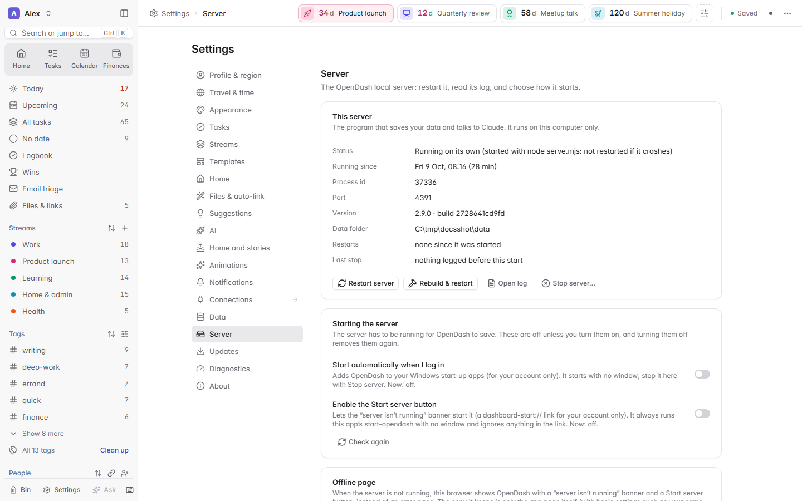

## Keyboard shortcuts

Press **?** (or the keyboard button in the top bar) for the shortcuts sheet.

| Keys | Action |
|---|---|
| Ctrl+K | search or jump to anything (the command palette) |
| Q | new task (quick add) |
| / | filter the current list (elsewhere it opens the palette) |
| Ctrl+J | the assistant |
| G then H / T / U / A / C / F / L / P / S / B / O | go to Home, Today, Upcoming, All tasks, Calendar, Money, Life, People, Settings, Bin, Logbook |
| G then G | All pages |
| V / Shift+V | next / previous layout (List, Board, Timeline, Matrix) |
| Shift+T | sweep today's leftovers to tomorrow |
| Alt+1 to 9 | your pinned pages |
| Ctrl+Z / Ctrl+Shift+Z (or Ctrl+Y) | undo / redo |
| Ctrl+\ | show or hide the sidebar |
| Ctrl+Shift+D | switch between light and dark |
| Ctrl+Shift+F | focus mode |
| Ctrl+E / Ctrl+P | export open tasks to Markdown / print the view |
| Esc | close, clear a selection or a filter |
| ? | the shortcuts sheet |

In a task list:

| Keys | Action |
|---|---|
| J / K, or Up / Down | next / previous task |
| Shift+Up / Shift+Down | extend the selection |
| Enter | open the task |
| X | complete or reopen |
| S | in progress |
| T | plan for today |
| D | due date |
| P, or 1 to 4 | priority menu, or set it (1 to 3; 4 for none) |
| E | edit the title |
| . | the task's menu |
| Delete | move to the Bin |
| Ctrl+A | select every task in the list |

Elsewhere:

- **Calendar**: T today, J / K or the arrow keys for previous / next, and
  M / W / D / A for month, week, day and agenda.
- **The centre card**: Up / Down (or J / K) for the previous / next task in
  the list, the task keys above, Ctrl+Enter completes or reopens it, Alt+Left
  goes back to the item you opened it from, M maximises it, Esc closes it.
- **Focus on Home**, with a row focused: Enter or Space opens or closes it,
  O opens the full card, X completes it, P pins it, H hides it for today,
  [ and ] move its date, Alt+Up / Alt+Down change its order.
- **Customise Home**: see [Home](#home).
- **Stories**: see [the player](#morning-brief-finish-the-day-and-the-weekly-review).
- **Right-click menus** for streams, tags and people also open with the Menu
  key or Shift+F10.

On a Mac, use Cmd instead of Ctrl.
